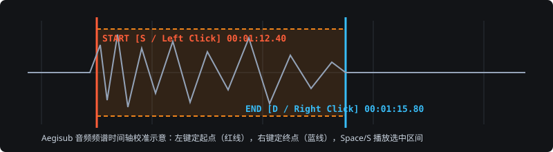

# Aegisub 字幕时间轴与样式基础

## 快速复习

- **开启频谱视图**：点击音频波形栏底部的「频谱模式（Spectrum mode）」按钮，人声起止边界比普通波形图清晰数倍。
- **高频打轴四键流**：
  - `鼠标左键`（或 `A`）：设定当前行**起点时间**
  - `鼠标右键`（或 `F`）：设定当前行**终点时间**
  - `S`（或 `Space`）：播放当前选中时间段音频
  - `G`（或 `Enter`）：提交当前行修改并**自动跳到下一行**
- **整体平移时间轴**：菜单栏 `计时（Timing） → 平移时间（Shift Times）`（快捷键 `Ctrl + I`）。

## 适用场景

为课程录像、实验操作演示视频、双语科普视频制作高精度 `.ass` 或 `.srt` 字幕，或修复外部下载字幕整体快慢偏移的问题。

## 前置准备

1. 准备待打轴视频文件（推荐 `.mp4` H.264 编码）与纯文本台词稿（每行一句）。
2. 打开 Aegisub，依次执行：
   - `文件 → 打开字幕`（或直接粘贴纯文本）
   - `视频 → 打开视频`（音频会自动关联载入）

## 操作步骤

### 1. 音频频谱精准打轴

在音频区域开启 **频谱模式（Spectrum）** + **自动滚动音频视图**，观察高亮亮斑对应的人声元音起点：



```text
打轴标准循环：
选中首行 → 左键点亮斑前 50ms → 右键点句尾后 150ms → 按 S 试听确认 → 按 G 提交并进入下一行
```

### 2. 批量平移错位字幕（Shift Times）

当视频片头增减了时长导致后续所有字幕整体慢了 `1.5 秒` 时：

1. 按 `Ctrl + I` 打开 **平移时间（Shift Times）**；
2. 时间填写 `0:00:01.50`，方向选择 **向前（Forward，延后出现）** 或 **向后（Backward，提前出现）**；
3. 影响行选择 **所有行（All rows）** 或 **选中行及后续行（Selection onward）**；
4. 时间字段勾选 **起始和结束时间（Start and End times）**，点击确定。

## 验证结果

- 播放视频预览窗口，字幕切入时间位于人声发声前 `0.05s ~ 0.10s`，无闪帧（相邻两句间隔小于 `0.2s` 时可使用 `计时 → 连结字幕` 自动对齐）。
- 导出 `.srt`（`文件 → 导出字幕 → UTF-8`）在播放器中无乱码。

## 常见问题与修复

- **问题**：压制或高分屏预览时 `.ass` 字幕字号异常巨大或位置偏离。  
  **原因**：脚本分辨率（PlayResX / PlayResY）未与视频分辨率对齐（默认常为 `384×288`）。  
  **修复**：点击菜单 `文件 → 属性`，点击「从视频获取分辨率（如 `1920 × 1080`）」，再在样式管理器中统一设定字号（1080p 下正文推荐 `52–60`）。
